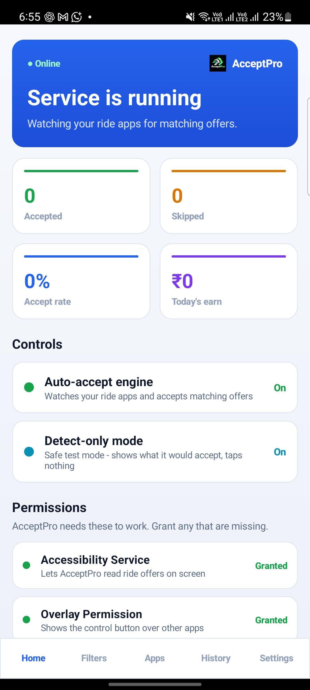

# AcceptPro (`com.ride.accepter`)

An Android assistant for gig-economy drivers. An AccessibilityService watches your
driver and delivery apps (Ola, Uber, Rapido, Namma Yatri, Zomato, Swiggy, Porter,
Dunzo, Blinkit, Zepto, Instamart), reads the offered fare and distance from the
screen, matches them against your filters, and taps **Accept** — or just logs the
offer in detect-only mode. Access is controlled by a cloud licensing system.



## Features

- **Auto-accept engine** — accessibility-based tap on the Accept button, with
  ADB/Shizuku fallback for reliable injection.
- **Filters** — fare range, distance, geo zones (map picker), per-app rules.
- **Detect-only mode** — dry run; shows what would be accepted, taps nothing.
- **Per-app controls** for 10+ gig platforms, with brand-keyword targeting.
- **Ride history** and today's earnings overview.
- Dark mode, multi-language UI, boot autostart, persistent foreground service.
- **Cloud licensing** — HWID-bound devices, Ed25519-signed short-lived tokens,
  remote config (`versionBlocked`, forced updates) and instant revocation.

## How it works

```
 phone (com.ride.accepter)                     cloud
┌──────────────────────────────────┐     ┌───────────────────────────────┐
│ RideAcceptorService              │     │ supabase/functions/api        │
│   AccessibilityService:          │     │   /v1/activate  /v1/refresh   │
│   detect fare -> filter -> tap   │◄───►│   /v1/validate  /v1/config    │
│ UI: Compose core (app/smali) +   │     │ Postgres: keys, devices,      │
│   dashboard & activation         │     │   audit                       │
│ Licence cache: signed tokens     │     ├───────────────────────────────┤
└──────────────────────────────────┘     │ api/ + public/  (Vercel)      │
                                         │   admin dashboard + REST API  │
                                         └───────────────────────────────┘
```

## Repository layout

| path | contents |
|---|---|
| `app/` | Android app module (apktool project): `smali/` core, `res/`, manifest |
| `app/java/` | dashboard / activation / device-identity sources → compiled to `unknown/classes2.dex` |
| `app/dist/` | build outputs; deliverable: signed `RideAccepter-mod.apk` |
| `app/original/` | baseline v6 build (used by the resource-ID verification step) |
| `license/` | licence core (key format, HWID, Ed25519 tokens), local server, CLI, tests |
| `api/`, `public/` | Vercel admin dashboard + REST API |
| `supabase/` | device-facing Edge Function + SQL migrations |
| `docs/` | deployment guide, screenshots; `docs/recovery-notes/` internal notes |
| `reference/` | decompiled reference copies of the shipped build (regenerable) |
| `tools/` | jadx, analysis helpers, signing keystore, key CLI helpers |

## Build & run

```bash
# run the prebuilt APK on a connected device
adb install -r app/dist/RideAccepter-mod.apk
adb shell monkey -p com.ride.accepter -c android.intent.category.LAUNCHER 1

# licence server + tests
npm test
ADMIN_PASSWORD='...' node license/src/server.ts   # http://localhost:8787/
```

Full APK build pipeline (dex → build → sign → verify → install) is in
[`app/README.md`](app/README.md). Admin dashboard deployment is in
[`docs/DEPLOYMENT.md`](docs/DEPLOYMENT.md). Licence/entitlement design:
[`license/README.md`](license/README.md).

## Development history

The Android core was reconstructed from the shipped v6 build (`app/original/`) after
the local source archive was lost with a previous laptop (Oct 2026); the
reconstruction and patch notes are kept in `docs/recovery-notes/`. The licensing
system (`license/`, `api/`, `supabase/`) was written from scratch alongside it.
